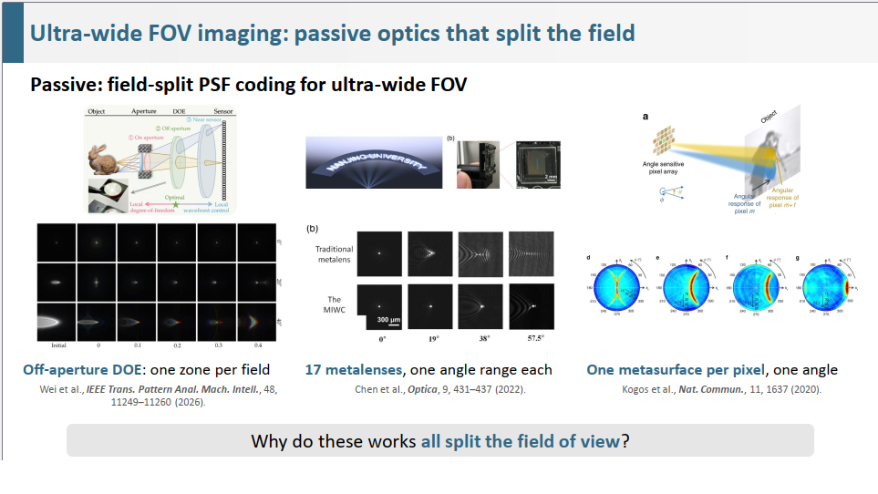
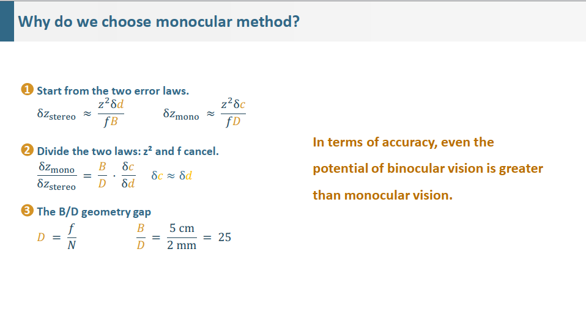
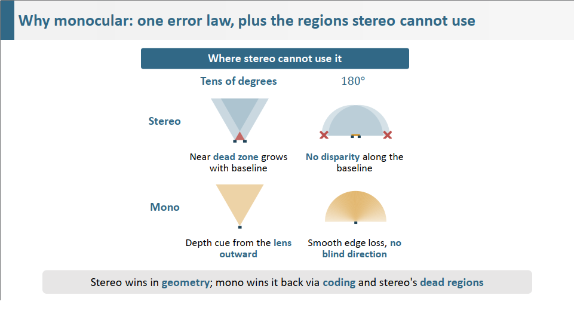
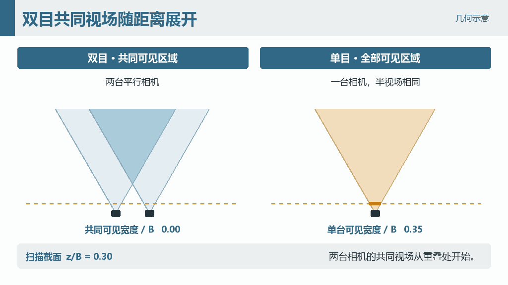
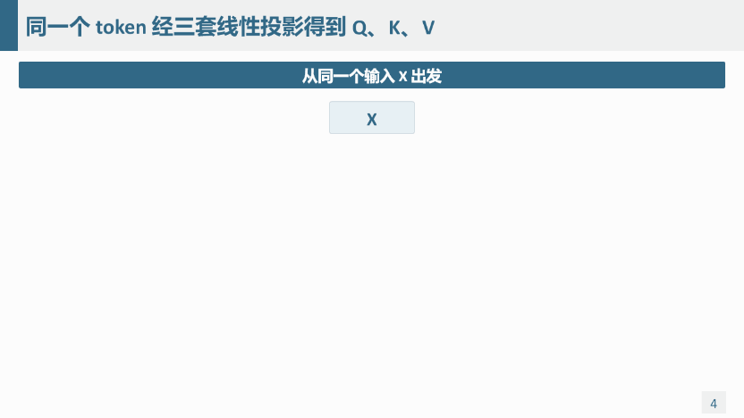

# 科研组会 PPT：一页讲清一件事

做组会时，听众要先看见证据，再听见解释。这个 skill 把一页收成图、公式和底部一句灰色结论：原理用 GIF 看过程，结构用一张图讲清关系，数字和版本对上之后才写进页面。

幻灯片用中文还是英文，由你这一轮指定，不默认英文。中文默认微软雅黑（Microsoft YaHei），西文默认 Calibri。

## 幻灯片示例

### 把三篇论文排在同一页

每列放一篇论文的结构图、结果图和出处。读完三列，再回到页底的问题：这些设计为什么都要分割视场？

[](assets/showcase-literature-comparison.png)

<table>
<tr>
<td width="50%" valign="top">
<strong>公式推导</strong><br>
两条误差律、消去共同项、代入尺度示例，一步接一步。<br><br>
<a href="assets/showcase-formula-derivation.png"></a>
</td>
<td width="50%" valign="top">
<strong>几何对照</strong><br>
用同一组视场条件比较双目和单目，直接标出重叠区域。<br><br>
<a href="assets/showcase-field-of-view.png"></a>
</td>
</tr>
</table>

## 动图示例

### 扫一遍双目的共同视场

虚线沿距离扫描。左图蓝线是两台相机在该截面都能看到的宽度，右图金线是单台相机的可见宽度。两边采用相同的半视场角，长度以基线为单位。



### Q、K、V 同步展开

从同一个输入 X 出发，三套投影在同一步出现。下一步再解释 Query、Key、Value 各自的作用。GIF 用停顿复现 PPT 的点击节奏。



[样页与动图的来源、帧含义和演示条件](assets/showcase.md)

## 为什么这样排

- **图像优先讲故事。** 一页回答一个问题。证据是图、公式或结构，解释放进讲稿，不把讲稿堆在页面上。
- **动态看机制。** 原理过程用 GIF，推导和流程可以按点击逐步出现，顺序跟讲稿一致。
- **灰色结论框。** 页底浅灰圆角条只放一句，告诉听众这一页要带走什么。
- **公式保持可编辑。** 行内公式、独立公式、带单位的数字都用 PowerPoint 原生公式（OMML）。当前工具写不出 OMML 时，先说明并等你同意，不会悄悄换成图片公式。
- **风格前后一致。** 16:9，主色 `#316886`，浅灰标题带加左侧蓝条。中文微软雅黑，西文 Calibri。可见文字用整数磅值，并且不小于 18 pt。
- **证据对得上来源。** 表、图和讲稿指向同一检查点、同一口径。不确定的话改成已核对的事实，或从页面拿掉，不靠加强语气变成定论。

## 快速开始

1. 克隆本仓库，让助手在做组会 PPT 时读 `SKILL.md`。
2. 写明这一轮的幻灯片语言、讲稿语言、数据文件，以及要不要先出几页预览。
3. 默认不放机构或实验室标识。需要 logo 时单独授权，并确认身份正确。
4. 按 [references/quality-checklist.md](references/quality-checklist.md) 验收。

可直接复制：

```text
请按 research-ppt-skill 帮我做组会 PPT。
幻灯片语言和备注讲稿都用中文。如果我改成英文页或中英分开，再按新要求，不要自行改成英文。
风格用默认 16:9 蓝灰白：中文微软雅黑，西文 Calibri。可见文字用整数磅值，且不小于 18 pt。
公式用原生可编辑公式（OMML），含行内数字和单位。写不出 OMML 时先告诉我，不要改成图片公式。
不要放机构或实验室 logo。只使用我提供的数据和底稿 [附文件]。
页面以图、公式和底部灰色结论框为主。请先给故事板，再做前一个模块的独立预览。
不要覆盖原文件，也不要恢复我删掉的页。
环境里如果没有微软雅黑或 Calibri，请在交付说明里写明实际字体。
```

已有删减稿、要求直接整合时，把最后两句换成：保留我的删页决定和手改内容，不恢复删页；统一页码和讲稿，另存新文件。更多提示词见 [references/prompt-templates.md](references/prompt-templates.md)。

## 默认规则

- 先核对模型、坐标、单位、检查点、数据集和显示口径，再写结论。
- 语言按本轮指定。中文页用微软雅黑，西文用 Calibri。缺字体就写明回退名称，不把回退说成默认字体已经装上。
- 可见字号为整数且 ≥ 18 pt，包括放置后的图内文字、引用和结论条。
- 引用统一为 `Author et al., Venue, vol, pages (year)`，期刊或会议名加粗并斜体。没有的卷期或页码留空。
- 新页先独立预览。你批准，或明确要求一次做完，再合并。
- 默认页脚只有页码，不放机构或实验室标识。
- 不覆盖原稿，不把删掉的页加回去。

## 仓库里有什么

- [SKILL.md](SKILL.md) 记录制作流程与默认约定。
- [风格指南](references/style-guide.md) 有版式、原生公式、引用和讲稿规范。
- [验收清单](references/quality-checklist.md) 适用于渲染与交付检查。
- [提示词模板](references/prompt-templates.md) 和 [匿名案例](references/anonymized-case.md) 可用于按任务调整流程。
- [本页展示素材](assets/showcase.md) 和 [早期样页图注](assets/captions.md) 记录各自的出处与演示条件。

## 维护

和自己课题组的固定模板不一致时，把差异写在当次任务配置里。不要把私人路径、未发表数据或机构标识提交回这个通用仓库。
