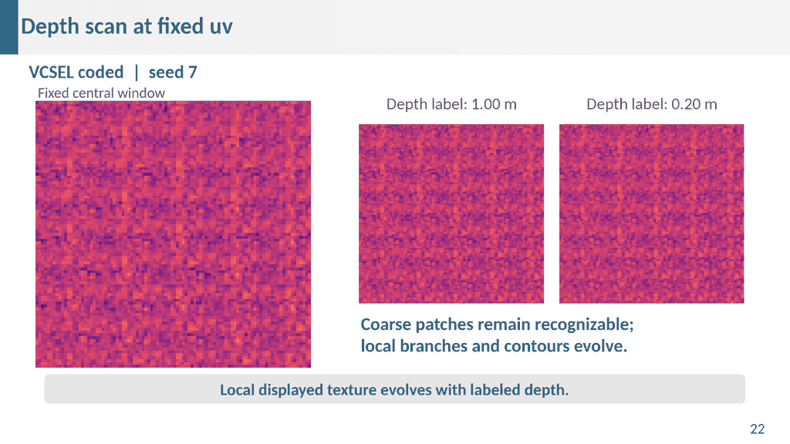
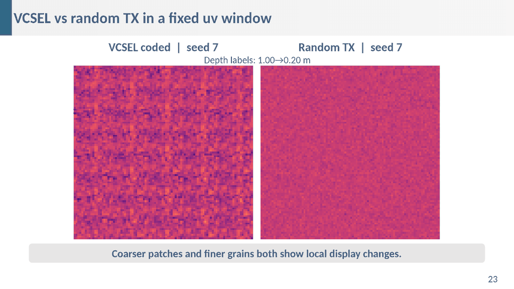
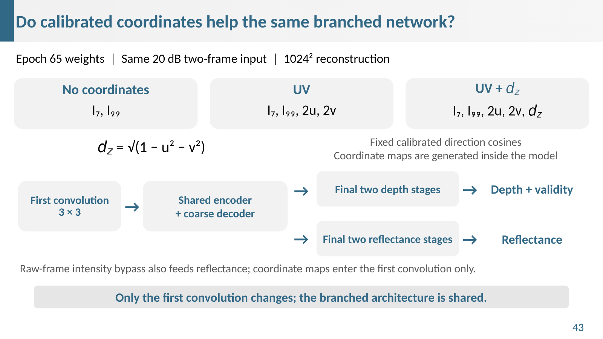

# 科研组会 PPT：一页讲清一件事

做组会时，听众要先看见证据，再听见解释。这个 skill 把一页收成图、公式和底部一句灰色结论：原理用 GIF 看过程，结构用一张图讲清关系，数字和版本对上之后才写进页面。

幻灯片用中文还是英文，由你这一轮指定，不默认英文。中文默认微软雅黑（Microsoft YaHei），西文默认 Calibri。

## 页面长什么样

下面三页是经授权的真实页适配，用来看排版，不是新做的实验结果。两段原理动画是仓库里的 GIF 原文件，会在页面上循环播放。

### 固定窗口里，纹理怎么变

左侧播放固定 uv 窗口的序列，右侧留下标注深度 1.00 m 和 0.20 m 的静态对照。底部灰框只保留一句定性结论。



### 两类 TX 放在同一视野里比较

VCSEL 与 random TX 的 seed 7 纹理并排播放，粗斑块和细颗粒都留在画面里。这是两类 TX，不是两次曝光，也不做双帧比值。



同一页的静态导出在 [assets/slide-fixed-uv.png](assets/slide-fixed-uv.png) 和 [assets/slide-comparison.png](assets/slide-comparison.png)。静态图只用于看版式，不能代替上面的 GIF。

### 结构用一条路径读完

输入怎么分组、主干哪些共享、分支输出到哪里，一页里走完。灰框把要记住的差异收成一句：只改变首层卷积。



## 为什么这样排

- **图像优先讲故事。** 一页回答一个问题。证据是图、公式或结构，解释放进讲稿，不把讲稿堆在页面上。
- **动态看机制。** 原理过程用 GIF，推导和流程可以按点击逐步出现，顺序跟讲稿一致。
- **灰色结论框。** 页底浅灰圆角条只放一句，告诉听众这一页要带走什么。
- **公式保持可编辑。** 行内公式、独立公式、带单位的数字都用 PowerPoint 原生公式（OMML）。当前工具写不出 OMML 时，先说明并等你同意，不会悄悄换成图片公式。
- **风格前后一致。** 16:9，主色 `#316886`，浅灰标题带加左侧蓝条。中文微软雅黑，西文 Calibri。可见文字用整数磅值，并且不小于 18 pt。
- **证据对得上来源。** 表、图和讲稿指向同一检查点、同一口径。不确定的话改成已核对的事实，或从页面拿掉，不靠加强语气变成定论。

## 快速开始

1. 克隆本仓库，让助手在做组会 PPT 时读 `SKILL.md`。
2. 写明这一轮的幻灯片语言、讲稿语言、数据文件，以及要不要先出几页预览。
3. 默认不放机构或实验室标识。需要 logo 时单独授权，并确认身份正确。
4. 按 [references/quality-checklist.md](references/quality-checklist.md) 验收。

可直接复制：

```text
请按 research-ppt-skill 帮我做组会 PPT。
幻灯片语言和备注讲稿都用中文。如果我改成英文页或中英分开，再按新要求，不要自行改成英文。
风格用默认 16:9 蓝灰白：中文微软雅黑，西文 Calibri。可见文字用整数磅值，且不小于 18 pt。
公式用原生可编辑公式（OMML），含行内数字和单位。写不出 OMML 时先告诉我，不要改成图片公式。
不要放机构或实验室 logo。只使用我提供的数据和底稿 [附文件]。
页面以图、公式和底部灰色结论框为主。请先给故事板，再做前一个模块的独立预览。
不要覆盖原文件，也不要恢复我删掉的页。
环境里如果没有微软雅黑或 Calibri，请在交付说明里写明实际字体。
```

已有删减稿、要求直接整合时，把最后两句换成：保留我的删页决定和手改内容，不恢复删页；统一页码和讲稿，另存新文件。更多提示词见 [references/prompt-templates.md](references/prompt-templates.md)。

## 默认规则

- 先核对模型、坐标、单位、检查点、数据集和显示口径，再写结论。
- 语言按本轮指定。中文页用微软雅黑，西文用 Calibri。缺字体就写明回退名称，不把回退说成默认字体已经装上。
- 可见字号为整数且 ≥ 18 pt，包括放置后的图内文字、引用和结论条。
- 引用统一为 `Author et al., Venue, vol, pages (year)`，期刊或会议名加粗并斜体。没有的卷期或页码留空。
- 新页先独立预览。你批准，或明确要求一次做完，再合并。
- 默认页脚只有页码，不放机构或实验室标识。
- 不覆盖原稿，不把删掉的页加回去。

## 仓库里有什么

```text
SKILL.md                          # 主流程
README.md
references/
  style-guide.md                  # 视觉、公式、引用、讲稿
  quality-checklist.md            # 验收
  prompt-templates.md             # 提示词
  anonymized-case.md              # 匿名过程
assets/
  principle-fixed-uv.gif          # 整页原理动画
  principle-comparison.gif        # 整页 TX 对照动画
  slide-fixed-uv.png              # 同页静态导出
  slide-comparison.png
  slide-coordinate-architecture.png
  captions.md                     # 图注与证据边界
  manifest.json
```

本仓库不包含造页脚本、字体文件、机构 logo 或可编辑的演示文稿。OMML 和点击动画取决于你当时的工具，开始前要检查。

## 这些示例能说明什么

它们说明图像优先、灰色结论框和整页原理动画怎么配合。完整图注在 [assets/captions.md](assets/captions.md)。使用时记住这几条：

- 三页来自最终演示文稿的适配：去掉了页脚标识，灰框收成独立短句。不是未改动的原页，也不是新验证的研究结果。
- 两段 GIF 各保留原序列 64 帧、100 ms/帧。比较页是两类 TX 的显示纹理，不是双曝光。只能作定性观察，不能据此推断物理光强、相关性或性能优劣。
- 这组图是英文页。渲染环境没有 Calibri，实际回退为 Carlito，不能当成微软雅黑的实装效果。

## 维护

和自己课题组的固定模板不一致时，把差异写在当次任务配置里。不要把私人路径、未发表数据或机构标识提交回这个通用仓库。
